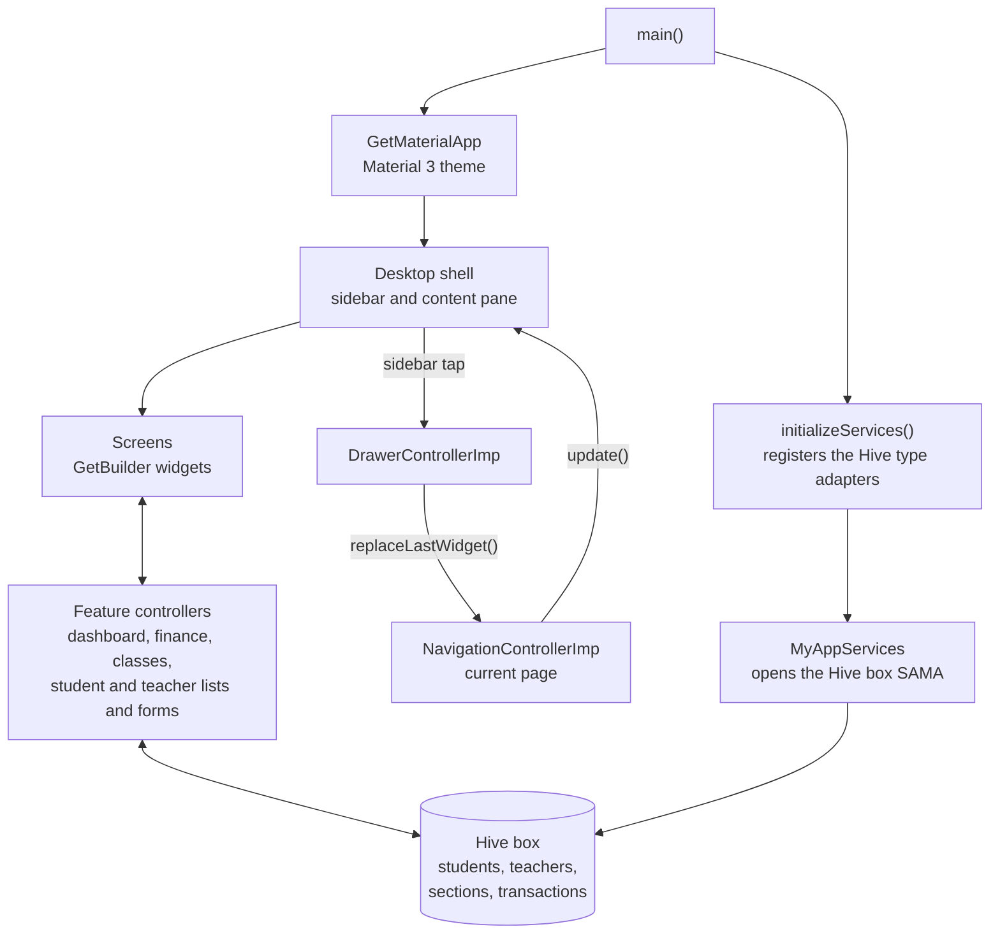
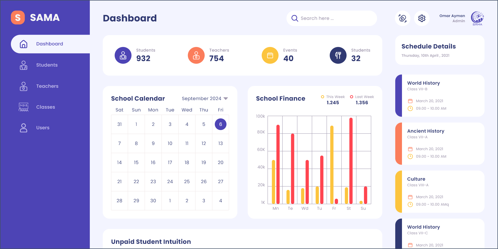
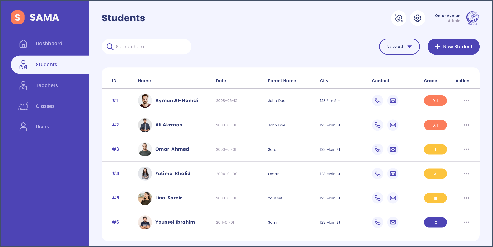
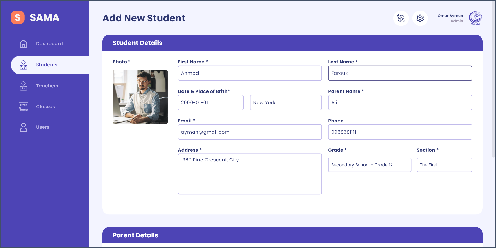
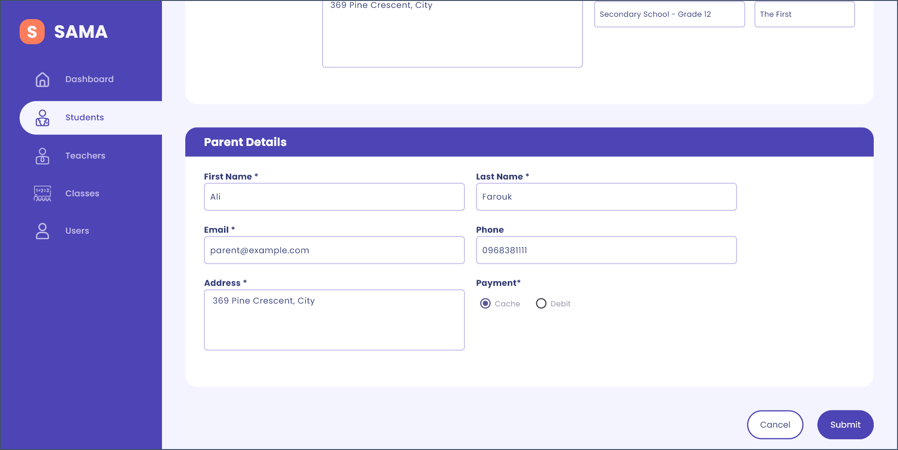
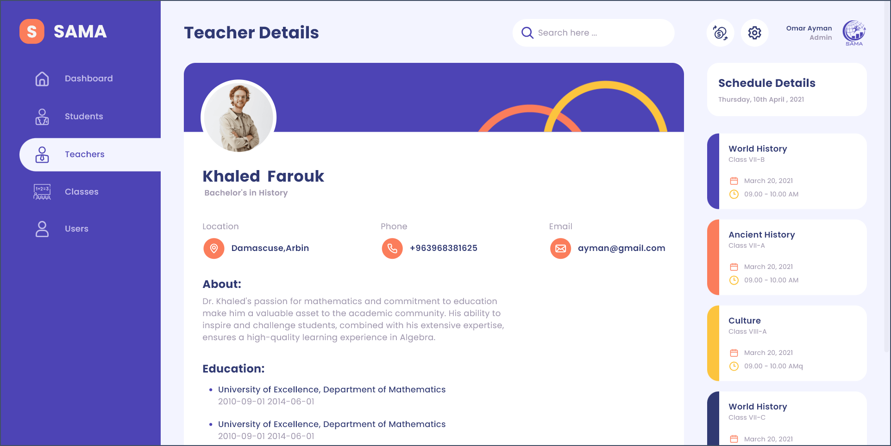
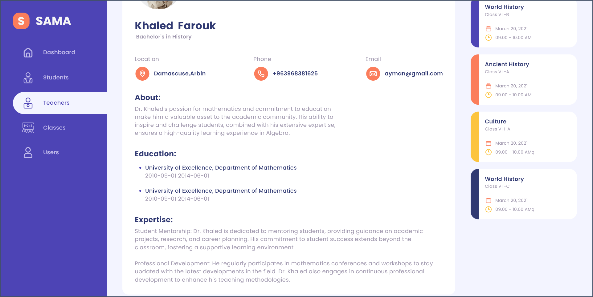
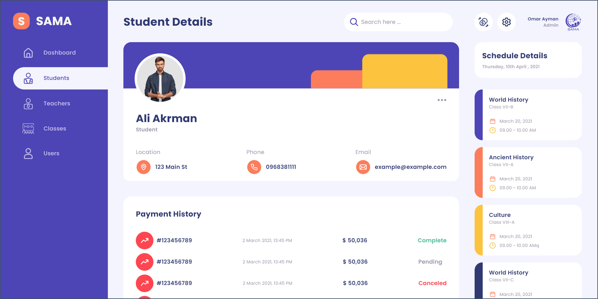
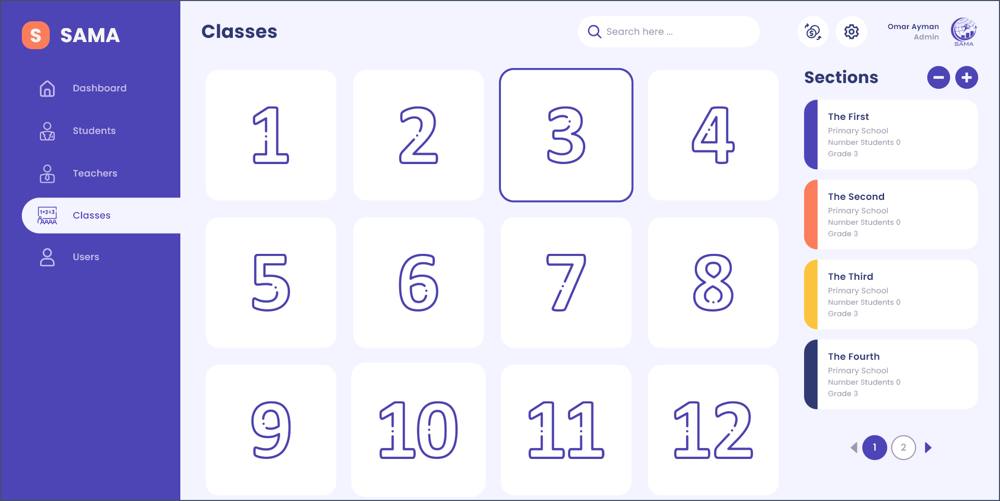
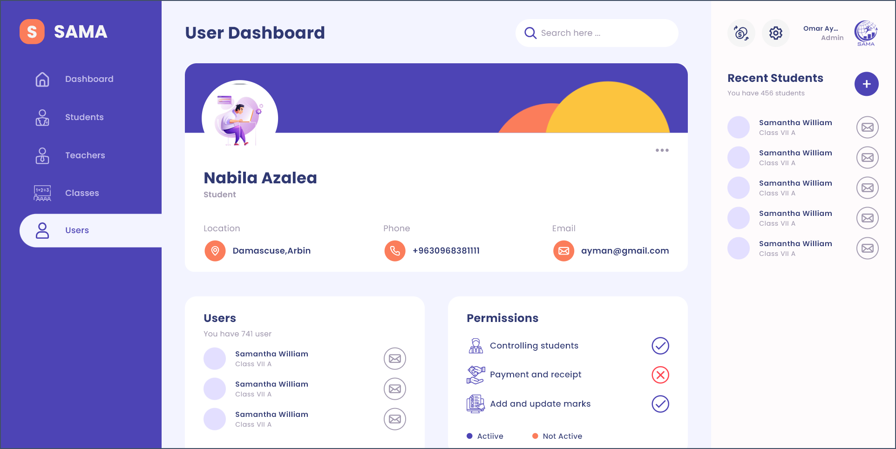

<div align="center">

# School Dashboard

**A Windows desktop app for school administration, built with Flutter, GetX and Hive.** Staff register students and teachers with photos, organize the twelve grades into sections, record financial transactions and see which students still owe tuition. Every record is stored on the local machine in a Hive database, and the interface, shown in the app as SAMA, is a single window with a sidebar and a content pane.

[](https://flutter.dev)
[](https://dart.dev)
[](#getting-started)
[](https://pub.dev/packages/get)
[](https://pub.dev/packages/hive)
[](https://pub.dev/packages/fl_chart)
[](LICENSE)

</div>

## Highlights

- **Dashboard.** A school calendar for any month of the current year, with weekday headers that follow the month and the current day highlighted; a School Finance bar chart drawn with fl_chart, with two bars per weekday (This Week and Last Week) that merge into their average when a day is touched; and a list of students with unpaid tuition.
- **Unpaid tuition.** For each student, the app adds up the transactions linked to that student. Students whose total is below the tuition amount of 1,000 appear on the dashboard, up to five at a time, with their ID, class (for example `VII A`) and remaining balance.
- **Student records.** The Students screen lists every stored student in a table with photo, name, date of birth, parent name, address, contact icons that show the phone number and email as tooltips, and a grade badge in Roman numerals colored by school stage. Clicking a row opens the student's profile with photo, name, address, phone and email. The row menu edits or deletes the record.
- **Student form.** One form adds or edits a student: student details, parent details, payment method (cash or debit), grade and section. The section picker lists the sections created for the selected grade, and when a grade has no section yet the app offers a shortcut to the Classes screen.
- **Photos.** On the student and teacher forms, click the photo box to choose an image file, or drag a PNG or JPG file onto it (desktop_drop). Double-clicking the box clears the photo.
- **Form validation.** The student form checks required fields, a length of 3 to 50 characters for names and addresses, the email format, phone numbers that start with `09` and have at least 10 characters, and dates of birth in `YYYY-MM-DD` format that are real calendar dates with a birth year 5 to 25 years before the current year.
- **Teacher records.** Teachers appear as a grid of cards with photo, name, degree and contact icons. A card opens the teacher's profile with degree, about text, education and expertise, and its menu edits or deletes the record. The teacher form covers personal details, photo, education (university, degree, start and end dates, city), an about text and an expertise text.
- **Classes and sections.** Twelve grade cards, from Grade 1 to Grade 12, belong to Primary School (1 to 6), Intermediate School (7 to 9) and Secondary School (10 to 12). Each grade holds up to ten sections, named The First to The Tenth, listed four per page. The plus button adds the next section to the selected grade; the minus button removes its newest section after a confirmation, together with the students assigned to it.
- **Transactions.** The transaction button in the page header opens a dialog that records a withdrawal, purchase, refund or payment with an amount. A payment is linked to a student chosen from a dropdown of stored students (dropdown_search). The dialog requires a type, a student for payments and a non-zero numeric amount, then saves the transaction with the current date and time and refreshes the unpaid tuition list.
- **Local storage.** On first launch the app creates a `sama` folder on the current user's desktop and opens a Hive box in it. Students, teachers, sections and transactions are written through hand-written Hive type adapters and stay on the machine between sessions.
- **Desktop layout.** A sidebar with Dashboard, Students, Teachers, Classes and Users; a Material 3 theme seeded from the primary purple `#4D44B5`; the Poppins typeface and SVG icons. Text and spacing scale with the window width relative to a 1920 px design, and font sizes stay between 80% and 120% of their design size by default. The Windows runner opens a 1280 x 720 window with a minimum size of 1000 x 400.

## Architecture



The app runs in one window without a route stack. `main()` calls `initializeServices()`, which registers the four Hive type adapters and opens the `SAMA` box through the `MyAppServices` singleton, and then starts a `GetMaterialApp`. The root widget, `SAMA`, passes the window size to `AdaptiveLayout`, which renders the `Desktop` shell from a width of 1200 px: the sidebar on the left and a content pane that rebuilds whenever the current page changes. Several pages place their main content next to a narrower panel on the right.

- **Navigation.** `NavigationControllerImp` holds the current page widget. `replaceLastWidget(NavigationEnum, info:)` replaces it and calls `update()`, which rebuilds the content pane. The `info` map carries the selected `StudentModel` or `TeacherModel` to the edit and detail pages. The destinations are Dashboard, Students, Teachers, Classes, Users, AddNewStudent, AddNewTeacher, StudentDetails and TeacherDetails.
- **State management.** GetX simple state management. Each feature has an abstract `GetxController` and an `...Imp` implementation that changes plain fields and calls `update()`, and widgets listen with `GetBuilder`. Pages register their controllers in `build` with `Get.put`, `Get.lazyPut` or `Get.lazyReplace`; the form controllers are replaced each time a form opens, so an edit always starts from the selected record.
- **Storage.** All records share one Hive box. Controllers read them with `box.values.whereType<T>()`, insert with `box.add`, and update a record in place by finding its index by `id` and calling `box.putAt`. New records get a random nine-digit `id`.

| Model | Hive type ID | Stored fields |
| --- | --- | --- |
| `StudentModel` | 0 | Name, date and place of birth, email, phone, address, parent name and contact details, grade, section, payment method, photo path, creation time |
| `TeacherModel` | 1 | Name, date and place of birth, email, phone, address, university, degree, start and end dates, city, about, expertise, photo path, creation time |
| `SectionModel` | 2 | Section name, school level, grade, number of students |
| `FinanceModel` | 3 | Transaction type, amount, date, linked student (for payments) |

## Tech stack

| Package | Version | Used for |
| --- | --- | --- |
| [Flutter](https://flutter.dev) | SDK | UI, Material 3 theming and the Windows desktop runner |
| [get](https://pub.dev/packages/get) | ^4.6.6 | `GetMaterialApp`, controllers with `GetBuilder`, dependency injection, snackbars and closing dialogs |
| [hive](https://pub.dev/packages/hive) | ^2.2.3 | Local database for students, teachers, sections and transactions |
| [fl_chart](https://pub.dev/packages/fl_chart) | ^0.66.2 | School Finance bar chart on the dashboard |
| [flutter_svg](https://pub.dev/packages/flutter_svg) | ^2.0.10+1 | SVG icons across the interface |
| [image_picker](https://pub.dev/packages/image_picker) | ^1.0.7 | Choosing student and teacher photos |
| [desktop_drop](https://pub.dev/packages/desktop_drop) | ^0.4.4 | Dropping photo files onto the forms |
| [dropdown_search](https://pub.dev/packages/dropdown_search) | ^5.0.6 | Transaction type and student pickers in the transaction dialog |
| [flutter_lints](https://pub.dev/packages/flutter_lints) | ^2.0.0 (dev) | Lint rules enabled in `analysis_options.yaml` |

## Getting started

### Prerequisites

- Windows 10 or later, 64-bit
- Flutter SDK 3.24 or later on the stable channel. The committed `pubspec.lock` requires Flutter 3.24.0 and Dart 3.5.0 or later; `pubspec.yaml` declares the Dart SDK range `>=3.2.3 <4.0.0`.
- Visual Studio 2022 with the **Desktop development with C++** workload, which Flutter uses to compile Windows apps
- Developer Mode turned on in Windows settings, because Flutter needs symbolic link support to build apps that use plugins such as image_picker and desktop_drop

Run `flutter doctor` to confirm that the Windows toolchain is ready.

### Installation

```bash
git clone https://github.com/aymansalkhatib/school-dashboard.git
cd school-dashboard
flutter pub get
```

No code generation step is needed: the Hive type adapters are written by hand in `lib/model/`.

### Running

```bash
flutter run -d windows
```

### Building a release

```bash
flutter build windows
```

The executable, `sama.exe`, and the files it needs are written to `build\windows\x64\runner\Release\`. Copy that whole folder to run the app on another machine.

### Data location

The app stores its records in `%USERPROFILE%\Desktop\sama`, in the box file `sama.hive`. To start with an empty database, close the app and delete that folder.

## Project structure

```text
school-dashboard/
├── assets/
│   ├── fonts/                 # Bundled font files; all text uses Poppins
│   ├── icons/                 # SVG and PNG icons
│   ├── images/                # Logo, default avatars and profile header artwork
│   ├── numbers/               # Grade number artwork for the Classes screen
│   └── screenshots/           # Screenshots used in this README
├── lib/
│   ├── controller/            # GetX controllers: navigation, sidebar, calendar, finance, classes,
│   │                          # student and teacher lists, student and teacher forms
│   ├── core/
│   │   ├── constants/         # Colors, text styles, asset paths, grade and section names
│   │   ├── enum/              # Navigation destinations, payment methods, transaction types
│   │   ├── helper/            # Date helpers, color extension, chart grid painter, ID generator
│   │   ├── shared/            # Reusable widgets: page header, buttons, form columns, profile card
│   │   ├── utils/             # Adaptive layout, size breakpoints, pagination, form validation
│   │   └── my_services.dart   # Opens the Hive box and registers the type adapters
│   ├── model/                 # Data classes and their Hive type adapters
│   ├── view/
│   │   ├── dashboard/         # Dashboard: calendar, finance chart, unpaid tuition list
│   │   ├── drawer/            # Sidebar
│   │   ├── view_all_student/  # Students table
│   │   ├── new_student/       # Add and edit student form
│   │   ├── student_details/   # Student profile
│   │   ├── view_all_teacher/  # Teachers grid
│   │   ├── new_teatcher/      # Add and edit teacher form
│   │   ├── teacher_details/   # Teacher profile
│   │   ├── classes/           # Grade cards
│   │   ├── trailing_*/        # Right-hand panels: sections, schedule, recent students
│   │   ├── users_details/     # Users screen
│   │   ├── desktop.dart       # Sidebar and content pane
│   │   └── sama.dart          # Root widget with the adaptive layout
│   └── main.dart              # Entry point and GetMaterialApp
├── windows/                   # Windows runner: window title, initial and minimum size
├── analysis_options.yaml
└── pubspec.yaml
```

## Screenshots

| Dashboard | Students |
| --- | --- |
|  |  |

| Add student: student details | Add student: parent details |
| --- | --- |
|  |  |

| Teachers | Teacher profile |
| --- | --- |
|  |  |

| Teacher profile, continued | Student profile |
| --- | --- |
|  |  |

| Classes and sections | Users |
| --- | --- |
|  |  |

## License

Copyright (c) 2024-2026 Ayman Al-Khatib. All rights reserved.

This project is proprietary. The source is public for viewing only, and no permission is granted to use, copy, modify or distribute it. See [LICENSE](LICENSE) for the full terms.
